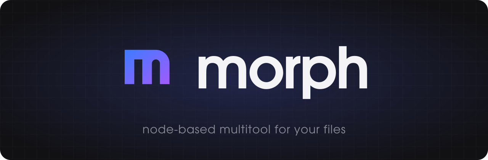
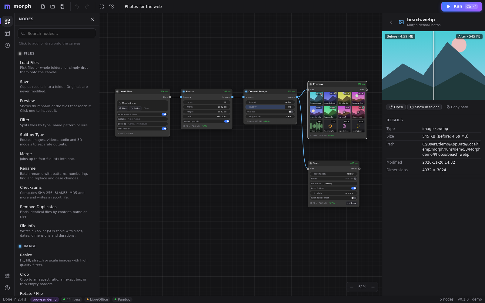

<p align='center'>
  
</p>

<p align='center'>
  <a href='https://github.com/kabiriyer3-cmyk/morph/releases/latest'></a>
  <a href='https://github.com/kabiriyer3-cmyk/morph/actions/workflows/ci.yml'></a>
  <a href='https://github.com/kabiriyer3-cmyk/morph/releases'></a>
  
  
  <a href='LICENSE'></a>
</p>

<p align='center'><b>English</b> · <a href='README.ru.md'>Русский</a></p>

**Morph** is a free, open-source desktop app for Windows and Linux that converts, compresses and batch-processes files of any kind. Convert a pile of files in two clicks with **Quick convert**, or wire up a node graph the way ComfyUI does it for AI images: **100 nodes** for photos, video, audio, PDF, Excel and other spreadsheets, office documents, text, data, 3D models and archives. Drop a folder onto the canvas, press **Run**, done. Your originals are never touched.

<p align='center'></p>

## Highlights

- **Convert anything.** The *Convert Anything* node and the Quick convert dialog know 70+ target formats and pick the right engine for every file: MP4, MKV, WebM, MOV, AVI and 9 more video containers, 13 audio formats, 12 image formats, Word, Excel, PowerPoint, PDF, CSV, JSON, 3D models and archives.
- **100 nodes with deep settings.** Codecs and CRF, bitrate or target file size, NVENC / QSV / AMF hardware encoding, color grading, subtitles, loudness and EQ, styled Excel output, table filters and math, PDF page tools, image effects, QR codes and much more. Rarely used options sit under *Advanced settings*, so nodes stay compact.
- **Quick convert.** `Ctrl+Shift+C`: drop files, pick a format, press **Convert**. Open the result as a workflow if you want to tweak it.
- **Command palette.** `Ctrl+K` finds any command, node, template or target format.
- **Tools in one click.** FFmpeg and Pandoc install from the **Tools** panel. LibreOffice, Ghostscript, Poppler and 7-Zip are detected automatically.
- **Previews everywhere.** Thumbnails inside the graph, a before / after slider for images, a video and audio player, an interactive 3D viewer, spreadsheet tables with sheet tabs and PDF details.
- **A polished editor.** Category colored nodes, minimap, favorites and recent nodes, 23 templates, six accent colors, dots or lines grid, English and Russian UI.
- **Fast, private, safe.** Rust backend that uses every CPU core. No accounts, no telemetry, nothing leaves your computer. Nodes work in a temporary folder and only **Save** writes to your disk.

## Download

| Platform | Package | |
|---|---|---|
| Windows 10/11 x64 | Installer `Morph_x.y.z_x64-setup.exe` | [Latest release](https://github.com/kabiriyer3-cmyk/morph/releases/latest) |
| Windows 10/11 x64 | MSI `Morph_x.y.z_x64_en-US.msi` | [Latest release](https://github.com/kabiriyer3-cmyk/morph/releases/latest) |
| Windows 10/11 x64 | Portable `Morph_x.y.z_x64_portable.exe`, no install needed | [Latest release](https://github.com/kabiriyer3-cmyk/morph/releases/latest) |
| Linux x64 | AppImage, runs on most distros | [Latest release](https://github.com/kabiriyer3-cmyk/morph/releases/latest) |
| Debian / Ubuntu / Mint | `.deb` | [Latest release](https://github.com/kabiriyer3-cmyk/morph/releases/latest) |
| Fedora / openSUSE | `.rpm` | [Latest release](https://github.com/kabiriyer3-cmyk/morph/releases/latest) |

Install the `.deb` with `sudo apt install ./Morph_*_amd64.deb`, the `.rpm` with `sudo dnf install ./Morph-*.x86_64.rpm`, or make the AppImage executable with `chmod +x Morph_*.AppImage`.

## Quick start

**Convert files in two clicks**

1. Press **Quick convert** in the top bar or `Ctrl+Shift+C`.
2. Drop files or folders into the dialog and pick a format, for example **MP4**, **XLSX** or **PDF**. Formats that do not fit your files are dimmed.
3. Press **Convert**. Results go next to the originals or into a folder of your choice.

**Build a workflow**

1. Open Morph. The **Photos for the web** template is loaded.
2. Drop a folder onto the canvas. The files go straight into the **Load Files** node.
3. Press **Run** or `Ctrl+Enter`. Thumbnails appear in **Preview** and the results land in `~/Morph Output` (change it in the **Save** node or in Settings).

Pick another template in the sidebar, press `Tab` or double-click the canvas to add a node, or press `Ctrl+K` to search everything.

## What converts to what

| From | To | Engine |
|---|---|---|
| **Video** | MP4, MKV, WebM, MOV, AVI, M4V, FLV, WMV, MPG, TS, M2TS, 3GP, OGV, MXF · soundtrack in any audio format · GIF or animated WebP · still frames | FFmpeg |
| **Audio** | MP3, M4A, AAC, Opus, OGG, FLAC, WAV, ALAC, AIFF, WMA, AC-3, AMR, M4R ringtone, M4B audiobook · MP4 / WebM / MKV / MOV | FFmpeg |
| **Images** (incl. HEIC, JXL, PSD, SVG, DDS) | PNG, JPG, WebP, AVIF, GIF, BMP, TIFF, ICO, TGA, QOI, PPM, EXR · PDF · slideshow video | built in, FFmpeg for video |
| **Spreadsheets** (XLSX, XLS, ODS, CSV, TSV) | XLSX, CSV, TSV, JSON, NDJSON, YAML, HTML, Markdown, XML, SQL, text table · ODS, XLS, PDF | built in · LibreOffice |
| **Office documents** (DOCX, DOC, ODT, RTF, PPTX, PPT, ODP) | PDF, DOCX, DOC, ODT, RTF, HTML, TXT, EPUB, PPTX, PPT, ODP, PNG, JPG | LibreOffice |
| **Markup** (Markdown, HTML, RST, LaTeX, Org, EPUB, Jupyter) | HTML, DOCX, ODT, EPUB, PDF, TXT, LaTeX, RST, Typst, AsciiDoc, Org, MediaWiki, Jira and more | built in · Pandoc |
| **PDF** | merge, split, keep / delete / rotate pages, compress, metadata · TXT · PNG / JPG pages | built in · Ghostscript or Poppler |
| **Data** (JSON, YAML, TOML, NDJSON, GeoJSON) | JSON, YAML, TOML, CSV, TSV, NDJSON | built in |
| **3D** (GLB, glTF, OBJ, STL, PLY, OFF) | GLB, glTF, OBJ, STL, PLY, OFF | built in |
| **Any files** | ZIP, 7z, tar, tar.gz, tar.xz, tar.zst, tar.bz2 · extract ZIP, 7z, RAR, ISO, CAB, tar | built in · 7-Zip for RAR, ISO, CAB and passwords |

## Nodes

| Category | Nodes |
|---|---|
| **Files** (16) | Load Files, Save, Preview, Filter, Split by Type, Merge, Rename, Sort & Pick, Organize into Folders (type, extension, date taken, size, pattern), Clean File Names (transliteration, safe names), Checksums, Verify Checksums, Remove Duplicates, File Info, File Report (HTML catalog with thumbnails), Split / Join Parts |
| **Convert** (1) | Convert Anything: one node, 70+ target formats, the engine is chosen per file |
| **Images** (22) | Resize, Crop, Rotate / Flip, Adjust, Effects & Filters, Convert Image (quality, lossless, target size, PNG optimization and palette), Logo Watermark, Text Overlay, Frame & Corners, Remove Background, Collage, Contact Sheet, Cut into Tiles, App Icons, Color Palette, QR Code, Photo Metadata (read or strip EXIF), Similar Images, Images to GIF, GIF to Frames, Image to Base64, Images to PDF |
| **Video** (19) | Convert Video (H.264, HEVC, AV1, VP9, ProRes, DNxHD and more, CRF / bitrate / target size, NVENC, QSV, AMF), Compress for Sharing (Discord, WhatsApp, Telegram, e-mail), Trim, Split, Transform, Reframe (9:16, 1:1, 4:5 with blurred background), Color & Cleanup (grading, denoise, stabilize, deinterlace), Fades / Reverse / Loop, Change Frame Rate (incl. smooth interpolation), Video Watermark, Subtitles (burn in, add, extract), Thumbnails, Extract Frames, Video to GIF, Extract Audio, Join Videos, Add Music / Voice, Slideshow Video, Media Report |
| **Audio** (8) | Convert Audio, Volume & Trim (loudness normalization, fades, speed), Audio Effects (EQ, noise reduction, compressor, pitch, echo, reverb, vocal removal), Join Audio (crossfades), Split Audio (at silences, by length), Remove Silence, Waveform / Spectrogram, Edit Tags (cover art) |
| **Documents** (4) | Office Convert (LibreOffice), Pandoc Convert (Markdown, DOCX, EPUB, LaTeX, Typst, AsciiDoc, wiki formats), Markdown to HTML, Extract Text |
| **PDF** (7) | Merge PDFs, Split PDF, Pages: Keep / Delete / Rotate, PDF Info & Metadata, Compress PDF, PDF to Text, PDF to Images |
| **Spreadsheets** (4) | Convert Spreadsheet (encodings, delimiters, dates, styled Excel with bold header, filters and fitted columns), Table Tools (keep / remove / rename columns, filter, sort, dedupe, transpose, fill, find and replace, split columns, math), Merge Tables, Split Table |
| **Data** (3) | Convert Data, JSON Tools (pretty, minify, sort keys, flatten, extract path, schema), Encode / Decode (Base64, hex, URL, HTML, Unicode, ROT13) |
| **Text** (6) | Text Tools (encodings incl. Windows-1251 and KOI8-R, line endings, find and replace), Line Tools (sort, dedupe, shuffle, number, wrap, head / tail), Merge Text Files, Split Text File, Extract Emails, Links…, Text Statistics |
| **3D** (3) | Convert 3D, Transform 3D (scale, units, rotate, center, up axis), Optimize 3D (weld, decimate, normals) |
| **Archives** (4) | Create Archive (ZIP, 7z, tar.*, optional password), Extract Archive, Compress File (zstd, gzip, xz, bzip2), Test Archives |
| **Utility** (3) | Note, Reroute, Switch |

Every node accepts any files. Files of a kind a node does not handle pass through unchanged, so a whole mixed folder can flow through a chain.

## Templates

**Photo, video & audio:** Photos for the web · Compress videos · Video to GIF · App icons · Any video to MP4 · Video for Discord · Vertical 9:16 video · Music to MP3 with tags · Clean up a podcast · Images for social media · Remove similar photos

**Documents, tables & data:** Photos to PDF · JSON to YAML · Excel to CSV · CSV to a polished Excel · Merge PDFs · Documents to PDF

**Files & archives:** Convert everything · 3D for the web · Backup with checksums · Find duplicates · Convert anything · Sort photos by date

## Shortcuts

| Keys | Action |
|---|---|
| `Ctrl+Enter` | Run or cancel |
| `Ctrl+K` | Command palette |
| `Ctrl+Shift+C` | Quick convert |
| `Tab` or double-click on the canvas | Search and add a node |
| `Delete` | Delete selected nodes |
| `Ctrl+C` / `Ctrl+V` / `Ctrl+D` | Copy / paste / duplicate |
| `Ctrl+Z` / `Ctrl+Y` | Undo / redo |
| `Ctrl+B` | Bypass selected nodes |
| `F` / `M` | Fit the graph / toggle the minimap |
| `Space` + drag or middle mouse button | Pan |
| Mouse wheel | Zoom |
| `Ctrl` + drag | Box select |
| `Ctrl+S` / `Ctrl+O` | Save / open a workflow |
| `?` | Help |

## External tools

Images, spreadsheets, PDF basics, 3D, archives, data and text work out of the box. Some nodes use well-known free tools. Open the **Tools** panel in the sidebar to see what is found: FFmpeg and Pandoc install there in one click, the others are picked up automatically from PATH, standard install folders or a `tools` folder next to `Morph.exe`. You can also set every path by hand.

| Tool | Used for | Windows | Linux |
|---|---|---|---|
| [FFmpeg](https://ffmpeg.org) | video and audio nodes, thumbnails, media reports | one click in **Tools** or `winget install Gyan.FFmpeg` | one click in **Tools** or `sudo apt install ffmpeg` |
| [Pandoc](https://pandoc.org) | Pandoc Convert, markup conversions | one click in **Tools** or `winget install JohnMacFarlane.Pandoc` | one click in **Tools** or `sudo apt install pandoc` |
| [LibreOffice](https://www.libreoffice.org) | Office Convert, Word / Excel / PowerPoint to PDF, XLS and ODS output | `winget install TheDocumentFoundation.LibreOffice` | `sudo apt install libreoffice` |
| [Ghostscript](https://ghostscript.com) | Compress PDF presets, PDF to Images | `winget install ArtifexSoftware.GhostScript` | `sudo apt install ghostscript` |
| [Poppler](https://poppler.freedesktop.org) | PDF to Images (alternative to Ghostscript) | bundled with many PDF tools | `sudo apt install poppler-utils` |
| [7-Zip](https://www.7-zip.org) | RAR, ISO, CAB and password protected archives | `winget install 7zip.7zip` | `sudo apt install p7zip-full` |

On Fedora use `sudo dnf install ...` (FFmpeg comes from [RPM Fusion](https://rpmfusion.org/Configuration)), on Arch `sudo pacman -S ffmpeg libreoffice-fresh pandoc ghostscript p7zip`.

## Build from source

Requirements: [Rust](https://rustup.rs) (stable), [Node.js](https://nodejs.org) 20 or newer and, on Linux, the WebKitGTK development packages:

```bash
sudo apt install libwebkit2gtk-4.1-dev libappindicator3-dev librsvg2-dev patchelf libgtk-3-dev build-essential
```

On Windows you need the Visual Studio C++ Build Tools and WebView2 (preinstalled on Windows 10 and 11).

```bash
git clone https://github.com/kabiriyer3-cmyk/morph.git
cd morph
npm install
npm run dev     # start the app
npm run build   # installers land in src-tauri/target/release/bundle
```

The UI is plain HTML, CSS and JavaScript in `src/` with no bundler. You can try it in a browser with built-in demo data:

```bash
python3 -m http.server 8080 --directory src
# then open http://localhost:8080/?demo=1
```

`npm run check` runs the static frontend checks and `npm run smoke` renders the demo in headless Chrome.

## Project layout

```
src/                 UI: index.html, css/, js/ (editor, widgets, inspector, quick convert, palette, minimap, tools panel, 3D viewer, i18n)
src-tauri/           Rust backend (Tauri 2)
  src/engine.rs      graph executor, progress events, work folders
  src/tools.rs       external tool detection, src/installer.rs one-click FFmpeg / Pandoc install
  src/ops/           node implementations: files, img, av (video, audio), audiofx, sheet, pdftools, docs, text2, data, mesh3d, arch, convert
  src/mesh.rs        mesh loading, writing, welding and decimation
assets/              logo, icon and banner (app icons are generated from assets/icon.svg at build time)
.github/actions/     CI and release steps used by the workflows
scripts/             frontend checks, smoke test, cargo error annotations
```

## Releasing

1. Bump `version` in `src-tauri/tauri.conf.json`, `src-tauri/Cargo.toml` and `package.json`.
2. Merge into `main`. The **Release** workflow builds the Windows and Linux packages on GitHub Actions and publishes the release `vX.Y.Z` with the installer, MSI, portable exe, AppImage, deb and rpm.

You can also push a `vX.Y.Z` tag or start **Release** manually in the Actions tab. Release notes come from `.github/release-notes.md`.

## FAQ

**Windows SmartScreen says the app comes from an unknown publisher.** The builds are not code-signed yet. Click *More info*, then *Run anyway*, or use the portable exe.

**The AppImage does not start.** Make it executable with `chmod +x`. Some distros also need `libfuse2` (`sudo apt install libfuse2`).

**Video nodes say FFmpeg was not found.** Open the **Tools** panel and press **Install** next to FFmpeg, or install it yourself (see [External tools](#external-tools)) and press **Detect again**.

**Can I convert a video or an Excel file to another format?** Yes. Use Quick convert, the *Convert Anything* node, or the dedicated *Convert Video* and *Convert Spreadsheet* nodes for full control.

**Where do intermediate files go?** Into `morph/runs` inside the system temp folder. Only the last few runs are kept, and *Settings, Clear cache* removes them.

**Does Morph upload my files anywhere?** No. Everything runs locally. The only network access is the optional one-click tool download you start yourself.

**Can it handle thousands of files?** Yes. Work is spread over all CPU cores. Previews show the first files and the inspector lists up to 500 results per output.

## Contributing

Issues and pull requests are welcome. A new node needs two pieces: an entry in `src/js/nodes.js` (sockets and widgets) and a handler in `src-tauri/src/ops/` registered in `ops/mod.rs`. CI checks that both sides match.

## License

[MIT](LICENSE) © Morph contributors
