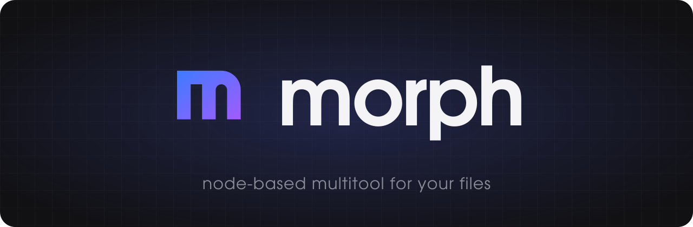
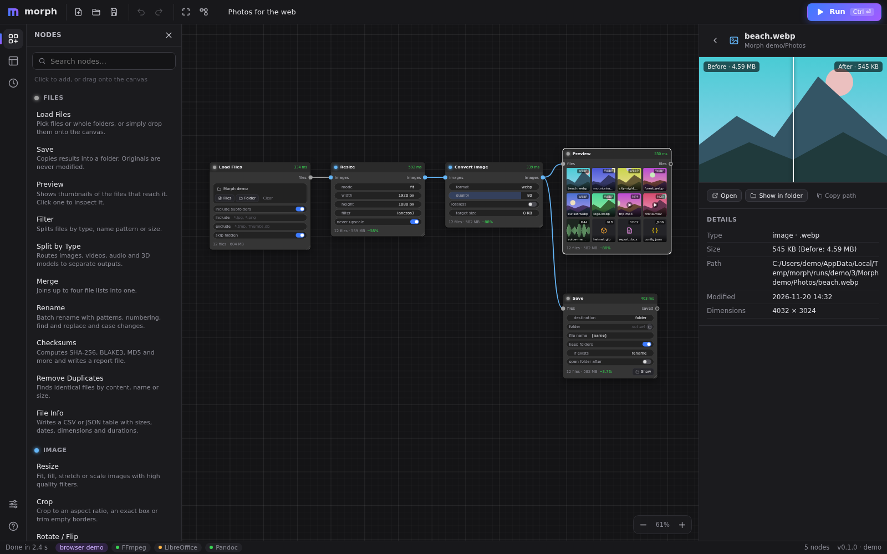

<p align='center'>
  
</p>

<p align='center'>
  <a href='https://github.com/kabiriyer3-cmyk/morph/releases/latest'></a>
  <a href='https://github.com/kabiriyer3-cmyk/morph/actions/workflows/ci.yml'></a>
  <a href='https://github.com/kabiriyer3-cmyk/morph/releases'></a>
  
  
  <a href='LICENSE'></a>
</p>

<p align='center'><a href='README.md'>English</a> · <b>Русский</b></p>

**Morph** — бесплатное приложение с открытым кодом для Windows и Linux, которое конвертирует, сжимает и пакетно обрабатывает файлы любых типов. Перегоните кучу файлов в другой формат в два клика через **Быструю конвертацию** или соберите нодовый граф, как в ComfyUI: **100 нод** для фото, видео, аудио, PDF, Excel и других таблиц, офисных документов, текста, данных, 3D-моделей и архивов. Перетащите папку на холст, нажмите **Запуск** — готово. Оригиналы никогда не изменяются.

<p align='center'></p>

## Возможности

- **Конвертирует что угодно.** Нода «Конвертировать что угодно» и окно быстрой конвертации знают 70+ целевых форматов и сами выбирают движок для каждого файла: MP4, MKV, WebM, MOV, AVI и ещё 9 видеоконтейнеров, 13 аудиоформатов, 12 форматов картинок, Word, Excel, PowerPoint, PDF, CSV, JSON, 3D-модели и архивы.
- **100 нод с глубокими настройками.** Кодеки и CRF, битрейт или целевой размер файла, аппаратное кодирование NVENC / QSV / AMF, цветокоррекция, субтитры, громкость и эквалайзер, оформленный Excel, фильтры и математика для таблиц, работа со страницами PDF, эффекты для картинок, QR-коды и многое другое. Редкие параметры спрятаны в «Дополнительно», поэтому ноды остаются компактными.
- **Быстрая конвертация.** `Ctrl+Shift+C`: перетащите файлы, выберите формат, нажмите **Конвертировать**. Результат можно открыть как граф и докрутить.
- **Палитра команд.** `Ctrl+K` находит любую команду, ноду, шаблон или формат.
- **Инструменты в один клик.** FFmpeg и Pandoc ставятся из панели **Инструменты**. LibreOffice, Ghostscript, Poppler и 7-Zip находятся автоматически.
- **Превью везде.** Миниатюры прямо в графе, слайдер «до/после» для картинок, плеер видео и аудио, интерактивный 3D-просмотрщик, таблицы с вкладками листов и сведения о PDF.
- **Продуманный редактор.** Ноды окрашены по категориям, миникарта, избранное и недавние ноды, 23 шаблона, шесть цветов акцента, сетка точками или линиями, интерфейс на русском и английском.
- **Быстро, приватно, безопасно.** Бэкенд на Rust задействует все ядра процессора. Без аккаунтов и телеметрии, файлы не покидают компьютер. Ноды работают во временной папке, а на диск пишет только «Сохранить».

## Скачать

| Платформа | Пакет | |
|---|---|---|
| Windows 10/11 x64 | Установщик `Morph_x.y.z_x64-setup.exe` | [Последний релиз](https://github.com/kabiriyer3-cmyk/morph/releases/latest) |
| Windows 10/11 x64 | MSI `Morph_x.y.z_x64_en-US.msi` | [Последний релиз](https://github.com/kabiriyer3-cmyk/morph/releases/latest) |
| Windows 10/11 x64 | Портативная версия `Morph_x.y.z_x64_portable.exe`, без установки | [Последний релиз](https://github.com/kabiriyer3-cmyk/morph/releases/latest) |
| Linux x64 | AppImage, работает на большинстве дистрибутивов | [Последний релиз](https://github.com/kabiriyer3-cmyk/morph/releases/latest) |
| Debian / Ubuntu / Mint | `.deb` | [Последний релиз](https://github.com/kabiriyer3-cmyk/morph/releases/latest) |
| Fedora / openSUSE | `.rpm` | [Последний релиз](https://github.com/kabiriyer3-cmyk/morph/releases/latest) |

`.deb` ставится командой `sudo apt install ./Morph_*_amd64.deb`, `.rpm` — `sudo dnf install ./Morph-*.x86_64.rpm`, а AppImage нужно сделать исполняемым: `chmod +x Morph_*.AppImage`.

## Быстрый старт

**Конвертация в два клика**

1. Нажмите **Быстрая конвертация** в верхней панели или `Ctrl+Shift+C`.
2. Перетащите в окно файлы или папки и выберите формат, например **MP4**, **XLSX** или **PDF**. Форматы, которые не подходят вашим файлам, приглушены.
3. Нажмите **Конвертировать**. Результаты лягут рядом с оригиналами или в выбранную папку.

**Свой граф**

1. Откройте Morph. Сразу загружен шаблон **Фото для сайта**.
2. Перетащите на холст папку — файлы попадут в ноду **Загрузить файлы**.
3. Нажмите **Запуск** или `Ctrl+Enter`. Миниатюры появятся в **Предпросмотре**, а результаты — в папке `~/Morph Output` (меняется в ноде **Сохранить** или в настройках).

Другие шаблоны — на боковой панели, `Tab` или двойной клик по холсту добавляет ноду, `Ctrl+K` ищет всё сразу. Язык интерфейса выбирается автоматически и меняется в настройках.

## Что во что конвертируется

| Откуда | Куда | Движок |
|---|---|---|
| **Видео** | MP4, MKV, WebM, MOV, AVI, M4V, FLV, WMV, MPG, TS, M2TS, 3GP, OGV, MXF · звуковая дорожка в любой аудиоформат · GIF или анимированный WebP · кадры | FFmpeg |
| **Аудио** | MP3, M4A, AAC, Opus, OGG, FLAC, WAV, ALAC, AIFF, WMA, AC-3, AMR, рингтон M4R, аудиокнига M4B · MP4 / WebM / MKV / MOV | FFmpeg |
| **Картинки** (в том числе HEIC, JXL, PSD, SVG, DDS) | PNG, JPG, WebP, AVIF, GIF, BMP, TIFF, ICO, TGA, QOI, PPM, EXR · PDF · видео-слайдшоу | встроенный, FFmpeg для видео |
| **Таблицы** (XLSX, XLS, ODS, CSV, TSV) | XLSX, CSV, TSV, JSON, NDJSON, YAML, HTML, Markdown, XML, SQL, текстовая таблица · ODS, XLS, PDF | встроенный · LibreOffice |
| **Офисные документы** (DOCX, DOC, ODT, RTF, PPTX, PPT, ODP) | PDF, DOCX, DOC, ODT, RTF, HTML, TXT, EPUB, PPTX, PPT, ODP, PNG, JPG | LibreOffice |
| **Разметка** (Markdown, HTML, RST, LaTeX, Org, EPUB, Jupyter) | HTML, DOCX, ODT, EPUB, PDF, TXT, LaTeX, RST, Typst, AsciiDoc, Org, MediaWiki, Jira и другие | встроенный · Pandoc |
| **PDF** | объединение, разделение, оставить / удалить / повернуть страницы, сжатие, метаданные · TXT · страницы в PNG / JPG | встроенный · Ghostscript или Poppler |
| **Данные** (JSON, YAML, TOML, NDJSON, GeoJSON) | JSON, YAML, TOML, CSV, TSV, NDJSON | встроенный |
| **3D** (GLB, glTF, OBJ, STL, PLY, OFF) | GLB, glTF, OBJ, STL, PLY, OFF | встроенный |
| **Любые файлы** | ZIP, 7z, tar, tar.gz, tar.xz, tar.zst, tar.bz2 · распаковка ZIP, 7z, RAR, ISO, CAB, tar | встроенный · 7-Zip для RAR, ISO, CAB и паролей |

## Ноды

| Категория | Ноды |
|---|---|
| **Файлы** (16) | Загрузить файлы, Сохранить, Предпросмотр, Фильтр, Разделить по типу, Объединить, Переименовать, Сортировка и выбор, Разложить по папкам (тип, расширение, дата съёмки, размер, шаблон), Чистые имена (транслит, безопасные имена), Контрольные суммы, Проверка контрольных сумм, Убрать дубликаты, Сведения о файлах, Отчёт о файлах (HTML-каталог с миниатюрами), Разрезать / склеить части |
| **Конвертация** (1) | Конвертировать что угодно: одна нода, 70+ форматов, движок выбирается для каждого файла |
| **Изображения** (22) | Изменить размер, Обрезать, Повернуть / отразить, Коррекция, Эффекты и фильтры, Конвертировать изображение (качество, без потерь, целевой размер, оптимизация и палитра PNG), Логотип-водяной знак, Текст на картинке, Рамка и углы, Удалить фон, Коллаж, Контактный лист, Нарезать на плитки, Иконки, Цветовая палитра, QR-код, Метаданные фото (прочитать или удалить EXIF), Похожие картинки, Картинки в GIF, GIF в кадры, Картинка в Base64, Изображения в PDF |
| **Видео** (19) | Конвертировать видео (H.264, HEVC, AV1, VP9, ProRes, DNxHD и другие, CRF / битрейт / целевой размер, NVENC, QSV, AMF), Сжать для отправки (Discord, WhatsApp, Telegram, почта), Обрезать, Разрезать, Трансформация, Кадрирование (9:16, 1:1, 4:5 с размытым фоном), Цвет и очистка (цветокоррекция, шумодав, стабилизация, деинтерлейс), Затухания / реверс / повтор, Частота кадров (включая плавную интерполяцию), Водяной знак на видео, Субтитры (вшить, добавить, извлечь), Превью-кадры, Извлечь кадры, Видео в GIF, Извлечь аудио, Склеить видео, Добавить музыку / голос, Слайд-шоу, Отчёт по медиа |
| **Аудио** (8) | Конвертировать аудио, Громкость и обрезка (нормализация, затухания, скорость), Аудиоэффекты (эквалайзер, шумодав, компрессор, тон, эхо, реверб, удаление вокала), Склеить аудио (кроссфейд), Разрезать аудио (по тишине, по длине), Убрать тишину, Волна / спектрограмма, Теги (с обложкой) |
| **Документы** (4) | Офисная конвертация (LibreOffice), Конвертация Pandoc (Markdown, DOCX, EPUB, LaTeX, Typst, AsciiDoc, вики-форматы), Markdown в HTML, Извлечь текст |
| **PDF** (7) | Объединить PDF, Разделить PDF, Страницы: оставить / удалить / повернуть, Инфо и метаданные PDF, Сжать PDF, PDF в текст, PDF в картинки |
| **Таблицы** (4) | Конвертировать таблицу (кодировки, разделители, даты, оформленный Excel с жирной шапкой, фильтрами и шириной столбцов), Инструменты таблиц (оставить / удалить / переименовать столбцы, фильтр, сортировка, дубли, транспонирование, заполнение, поиск и замена, разбиение столбцов, математика), Объединить таблицы, Разделить таблицу |
| **Данные** (3) | Конвертировать данные, Инструменты JSON (форматирование, минификация, сортировка ключей, flatten, путь, схема), Кодировать / декодировать (Base64, hex, URL, HTML, Unicode, ROT13) |
| **Текст** (6) | Текстовые инструменты (кодировки, включая Windows-1251 и KOI8-R, переводы строк, поиск и замена), Работа со строками (сортировка, дубли, перемешивание, нумерация, перенос, первые / последние строки), Склеить тексты, Разрезать текст, Найти email, ссылки…, Статистика текста |
| **3D** (3) | Конвертировать 3D, Трансформация 3D (масштаб, единицы, поворот, центрирование, ось «вверх»), Оптимизация 3D (сварка вершин, упрощение, нормали) |
| **Архивы** (4) | Создать архив (ZIP, 7z, tar.*, по желанию с паролем), Распаковать архив, Сжать файл (zstd, gzip, xz, bzip2), Проверить архивы |
| **Прочее** (3) | Заметка, Переходник, Переключатель |

Любая нода принимает любые файлы: те, что ей не по профилю, проходят дальше без изменений. Поэтому в цепочку можно подать целую папку вперемешку.

## Шаблоны

**Фото, видео и звук:** Фото для сайта · Сжать видео · Видео в GIF · Иконки приложения · Любое видео в MP4 · Видео для Discord · Вертикальное видео 9:16 · Музыка в MP3 с тегами · Чистка подкаста · Картинки для соцсетей · Удалить похожие фото

**Документы, таблицы и данные:** Фото в PDF · JSON в YAML · Excel в CSV · CSV в красивый Excel · Объединить PDF · Документы в PDF

**Файлы и архивы:** Медиа по форматам · 3D для веба · Бэкап с контрольными суммами · Найти дубликаты · Конвертировать всё · Разобрать фото по датам

## Горячие клавиши

| Клавиши | Действие |
|---|---|
| `Ctrl+Enter` | Запуск или остановка |
| `Ctrl+K` | Палитра команд |
| `Ctrl+Shift+C` | Быстрая конвертация |
| `Tab` или двойной клик по холсту | Найти и добавить ноду |
| `Delete` | Удалить выбранные ноды |
| `Ctrl+C` / `Ctrl+V` / `Ctrl+D` | Копировать / вставить / дублировать |
| `Ctrl+Z` / `Ctrl+Y` | Отменить / повторить |
| `Ctrl+B` | Пропускать выбранные ноды |
| `F` / `M` | Показать весь граф / миникарта |
| `Пробел` + перетаскивание или средняя кнопка мыши | Двигать холст |
| Колесо мыши | Масштаб |
| `Ctrl` + перетаскивание | Выделение рамкой |
| `Ctrl+S` / `Ctrl+O` | Сохранить / открыть граф |
| `?` | Справка |

## Внешние программы

Картинки, таблицы, базовые операции с PDF, 3D, архивы, данные и текст работают сразу. Часть нод использует известные бесплатные программы. Откройте панель **Инструменты** на боковой панели: FFmpeg и Pandoc ставятся там в один клик, остальное Morph находит сам (PATH, стандартные папки установки или папка `tools` рядом с `Morph.exe`). Любой путь можно задать вручную.

| Программа | Для чего | Windows | Linux |
|---|---|---|---|
| [FFmpeg](https://ffmpeg.org) | ноды видео и аудио, миниатюры, отчёты по медиа | в один клик в **Инструментах** или `winget install Gyan.FFmpeg` | в один клик в **Инструментах** или `sudo apt install ffmpeg` |
| [Pandoc](https://pandoc.org) | конвертация Pandoc, форматы разметки | в один клик в **Инструментах** или `winget install JohnMacFarlane.Pandoc` | в один клик в **Инструментах** или `sudo apt install pandoc` |
| [LibreOffice](https://ru.libreoffice.org) | офисная конвертация, Word / Excel / PowerPoint в PDF, вывод в XLS и ODS | `winget install TheDocumentFoundation.LibreOffice` | `sudo apt install libreoffice` |
| [Ghostscript](https://ghostscript.com) | пресеты сжатия PDF, PDF в картинки | `winget install ArtifexSoftware.GhostScript` | `sudo apt install ghostscript` |
| [Poppler](https://poppler.freedesktop.org) | PDF в картинки (замена Ghostscript) | входит во многие PDF-утилиты | `sudo apt install poppler-utils` |
| [7-Zip](https://www.7-zip.org) | RAR, ISO, CAB и архивы с паролем | `winget install 7zip.7zip` | `sudo apt install p7zip-full` |

В Fedora — `sudo dnf install ...` (FFmpeg берётся из [RPM Fusion](https://rpmfusion.org/Configuration)), в Arch — `sudo pacman -S ffmpeg libreoffice-fresh pandoc ghostscript p7zip`.

## Сборка из исходников

Нужны [Rust](https://rustup.rs) (stable), [Node.js](https://nodejs.org) 20+ и, на Linux, пакеты разработки WebKitGTK:

```bash
sudo apt install libwebkit2gtk-4.1-dev libappindicator3-dev librsvg2-dev patchelf libgtk-3-dev build-essential
```

На Windows нужны Visual Studio C++ Build Tools и WebView2 (уже есть в Windows 10 и 11).

```bash
git clone https://github.com/kabiriyer3-cmyk/morph.git
cd morph
npm install
npm run dev     # запустить приложение
npm run build   # установщики появятся в src-tauri/target/release/bundle
```

Интерфейс — обычные HTML, CSS и JavaScript в `src/`, без сборщика. Его можно попробовать в браузере на встроенных демо-данных:

```bash
python3 -m http.server 8080 --directory src
# затем откройте http://localhost:8080/?demo=1
```

`npm run check` запускает статические проверки фронтенда, а `npm run smoke` рендерит демо в headless Chrome.

## Структура проекта

```
src/                 интерфейс: index.html, css/, js/ (редактор, виджеты, инспектор, быстрая конвертация, палитра, миникарта, панель инструментов, 3D, i18n)
src-tauri/           бэкенд на Rust (Tauri 2)
  src/engine.rs      исполнение графа, события прогресса, рабочие папки
  src/tools.rs       поиск внешних программ, src/installer.rs установка FFmpeg / Pandoc в один клик
  src/ops/           реализации нод: files, img, av (видео, аудио), audiofx, sheet, pdftools, docs, text2, data, mesh3d, arch, convert
  src/mesh.rs        чтение и запись 3D, сварка и упрощение сеток
assets/              логотип, иконка и баннер (иконки приложения генерируются из assets/icon.svg при сборке)
.github/actions/     шаги CI и релиза
scripts/             проверки фронтенда, smoke-тест, аннотации ошибок cargo
```

## Выпуск релиза

1. Поднимите `version` в `src-tauri/tauri.conf.json`, `src-tauri/Cargo.toml` и `package.json`.
2. Смерджите в `main`. Workflow **Release** соберёт пакеты для Windows и Linux на GitHub Actions и опубликует релиз `vX.Y.Z` с установщиком, MSI, портативным exe, AppImage, deb и rpm.

Также можно запушить тег `vX.Y.Z` или запустить **Release** вручную на вкладке Actions. Текст релиза берётся из `.github/release-notes.md`.

## Частые вопросы

**Windows SmartScreen пишет, что издатель неизвестен.** Сборки пока не подписаны. Нажмите *Подробнее*, затем *Выполнить в любом случае*, или возьмите портативную версию.

**AppImage не запускается.** Сделайте файл исполняемым: `chmod +x`. На некоторых дистрибутивах нужен ещё `libfuse2` (`sudo apt install libfuse2`).

**Ноды видео пишут, что FFmpeg не найден.** Откройте панель **Инструменты** и нажмите **Установить** рядом с FFmpeg, либо установите его сами (см. [Внешние программы](#внешние-программы)) и нажмите **Найти заново**.

**Можно конвертировать видео или Excel-таблицу в другой формат?** Да. Через быструю конвертацию, ноду «Конвертировать что угодно» или отдельные ноды «Конвертировать видео» и «Конвертировать таблицу» с полным набором настроек.

**Куда пишутся промежуточные файлы?** В `morph/runs` во временной папке системы. Хранятся только последние запуски, а *Настройки, Очистить кэш* удаляет их.

**Morph куда-нибудь отправляет мои файлы?** Нет. Всё работает локально. В сеть приложение ходит только когда вы сами нажимаете установку инструмента.

**Справится с тысячами файлов?** Да. Работа распределяется по всем ядрам процессора. Превью показывает первые файлы, а инспектор — до 500 результатов на выход.

## Участие

Issues и pull requests приветствуются. Новая нода — это две части: запись в `src/js/nodes.js` (сокеты и виджеты) и обработчик в `src-tauri/src/ops/`, зарегистрированный в `ops/mod.rs`. CI проверяет, что обе стороны совпадают.

## Лицензия

[MIT](LICENSE) © Morph contributors
